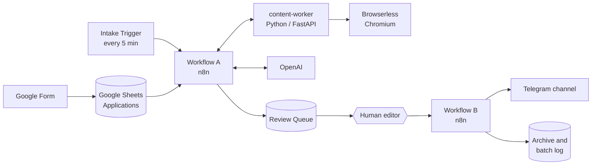

# EduJobs Autopilot

**English** | [Русский](README.ru.md)

An automation pipeline for [EduJobs](https://t.me/edujobs), a Telegram channel with vacancies in education and EdTech. Employers submit a vacancy through a Google Form. The system checks every application, rewrites it into a channel post, and hands it to a human editor. The editor approves or rejects it in Google Sheets, and the approved batch is published to Telegram.

The system has been running in production since October 2026.

## The problem

Not every submission belongs in the channel. Some are not vacancies at all, link to dead or unrelated pages, offer sales or infobusiness work, or have no usable contact. Accepted ones still have to be edited into one consistent post format without changing their meaning, and a batch of posts has to reach the channel in the right order, exactly once.

## How it works



**Workflow A — one application per run.** It normalizes the submission and runs cheap deterministic checks first: project link, contact, Telegram-bot-only contact, duplicates. The content worker then fetches both submitted links: HTML, PDF and DOCX, with a headless browser fallback for JavaScript pages. An LLM decides eligibility under an explicit policy with a closed list of 15 rejection reasons and picks the smallest editorial intervention: `KEEP`, `MINIMAL` or `ENRICH`. When the text needs editing, an LLM editor rewrites it and an LLM validator checks it against the sources for factual faithfulness. Code checks every LLM response against its contract and falls back conservatively when validation fails. The result is written back to the sheet as `READY_FOR_PUBLISH`, `REJECTED`, `NEEDS_REVIEW` or `ERROR`, with reasons and telemetry.

**Workflow B — human-reviewed publication.** The editor sees every unresolved application in a Review Queue tab, can edit any publication field, marks rows `PUBLISH` or `REJECT`, sets the order and ticks one control checkbox. Workflow B freezes the approved rows into a batch, runs a preflight over every payload and the channel before the first send, then publishes a start marker, one post per vacancy and an end marker. Telegram message IDs are saved after each send. Workflow B makes no LLM calls: formatting, contact normalization and links are deterministic.

## Engineering highlights

- **Deterministic first, LLM only for judgment.** Anything code can decide reliably is decided in code. The LLM handles eligibility, editing and semantic validation only, and every response is checked against a typed contract.
- **Untrusted input by design.** Fetched pages are treated as data, never as instructions, so prompt injection in a vacancy page cannot approve it. The worker allows only `http`/`https`, blocks localhost and private networks (SSRF protection), and limits redirects, download size and extracted text.
- **Human in the loop.** The machine decision is advisory. A person makes the final publish or reject decision, and the latest human edits are what gets published.
- **Safe publication and recovery.** A batch is a frozen snapshot. Nothing is sent until the whole batch passes preflight. A failed attempt is recovered by cleaning up its messages and restarting the same batch from the start, never by a partial resume that could duplicate or reorder posts.
- **Workflows as code.** The n8n workflows (about 120 nodes for Workflow A and 47 for Workflow B) are generated by JavaScript builders, so they can be reviewed, diffed and tested like code. The generated JSON is never edited by hand, and credentials are referenced by ID, never embedded.
- **Spec-driven development.** Two canonical specifications define every business rule and acceptance check. Status and decision logs record evidence for each milestone.

## Tech stack

| Area | Technology |
| --- | --- |
| Orchestration | n8n 2.35 (self-hosted, Docker Compose, Postgres) |
| Content worker | Python 3.12, FastAPI, httpx, BeautifulSoup, pypdf, python-docx |
| JavaScript rendering | Browserless (headless Chromium) |
| LLM | OpenAI API |
| Data and review UI | Google Sheets API, Google Forms |
| Publication | Telegram Bot API |
| Workflow builders and logic | Node.js (ES modules) |
| Tests | `node:test`, pytest |

## Tests

All tests run offline, with no network access, credentials or production data:

```sh
node --test
```

```sh
cd worker && python -m pytest
```

At the time of publication: **797 Node.js tests** cover the workflow builders, deterministic logic, Google Sheets and Telegram integration with fixtures, and the batch runner. **81 Python tests** cover the content worker: fetching, extraction, the browser fallback and security checks. An offline evaluation harness (`n8n/eval-cases.mjs`, `n8n/eval-replay.mjs`) replays recorded cases to compare prompt and model configurations.

## Repository structure

```text
.
├── WORKFLOW_A_IMPLEMENTATION_SPEC.md   canonical spec: application processing
├── WORKFLOW_B_IMPLEMENTATION_SPEC.md   canonical spec: review and Telegram publication
├── n8n/                                workflow builders, Workflow B modules, tests, eval harness
├── workflow-logic/                     deterministic helpers shared by both workflows
├── worker/                             content-worker service (FastAPI) and its tests
├── tests/                              sandbox and batch-runner tests
├── deploy/server/                      server installation templates (no secrets)
├── docker-compose.yml                  local sandbox: n8n, Browserless, content-worker
├── docs/                               runbooks, decision logs, implementation status
└── AGENTS.md, CLAUDE.md                rules for the AI coding agents
```

## Running it locally

The local sandbox runs n8n, Browserless and the content worker in Docker. You need your own non-production Google Sheet, a Google service account and an OpenAI API key. The full step-by-step guide is in [docs/LOCAL_SANDBOX.md](docs/LOCAL_SANDBOX.md). Server installation is described in [docs/SERVER_RUNBOOK.md](docs/SERVER_RUNBOOK.md).

## How it was built

I designed the product, wrote the specifications, made every business and acceptance decision, and tested the system against real applications. The code was written by AI coding agents (Claude Code and OpenAI Codex), working from the specifications under the rules in [AGENTS.md](AGENTS.md). Each change was verified with tests and recorded in the status and decision logs in [docs/](docs/).

## License

© 2026 Stepan Vilenchik. All rights reserved. The source code is published for review only. It may not be copied, modified or used without written permission.
