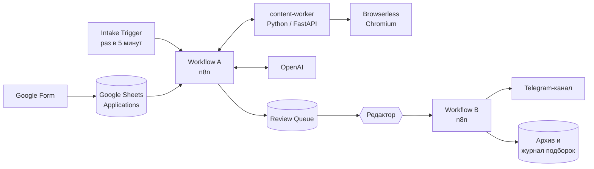

# EduJobs Autopilot

[](https://github.com/vlnchk/edujobs-autopilot/actions/workflows/ci.yml)


[English](README.md) | **Русский**

Система автоматизации для [EduJobs](https://t.me/edujobs) — Telegram-канала с вакансиями в образовании и EdTech. Работодатели присылают вакансию через Google Form. Система проверяет каждую заявку, переписывает её в пост для канала и передаёт редактору. Редактор одобряет или отклоняет заявку в Google Sheets, и одобренная подборка публикуется в Telegram.

Система работает в продакшене с октября 2026 года.

## Задача

Не каждая заявка подходит для канала. Часть — вовсе не вакансии, ведут на мёртвые или посторонние страницы, предлагают продажи или инфобизнес либо не содержат рабочего контакта. Подходящие заявки нужно привести к единому формату поста, не исказив смысл, а подборка постов должна попасть в канал в нужном порядке и ровно один раз.

## Как это работает



**Workflow A — одна заявка за запуск.** Он нормализует заявку и сначала выполняет дешёвые детерминированные проверки: ссылка на проект, контакт, контакт только через Telegram-бота, дубликаты. Затем content-worker загружает обе присланные ссылки: HTML, PDF и DOCX, а для страниц на JavaScript — через headless-браузер. LLM решает, подходит ли вакансия, по явной политике с закрытым списком из 15 причин отказа, и выбирает минимально необходимую правку: `KEEP`, `MINIMAL` или `ENRICH`. Если текст нужно править, LLM-редактор переписывает его, а LLM-валидатор сверяет результат с источниками на фактическую точность. Код проверяет каждый ответ LLM на соответствие контракту и, если проверка не пройдена, консервативно откатывается к безопасному варианту. Результат записывается обратно в таблицу как `READY_FOR_PUBLISH`, `REJECTED`, `NEEDS_REVIEW` или `ERROR` — с причинами и телеметрией.

**Workflow B — публикация после проверки человеком.** Редактор видит все нерешённые заявки во вкладке Review Queue, может поправить любое поле публикации, отмечает строки `PUBLISH` или `REJECT`, задаёт порядок и ставит одну галочку запуска. Workflow B фиксирует одобренные строки в подборку и до первой отправки проверяет каждый пост и сам канал. Затем публикует стартовый маркер, по одному посту на вакансию и финальный маркер. ID сообщений Telegram сохраняются после каждой отправки. Workflow B не вызывает LLM: форматирование, нормализация контактов и ссылки детерминированы.

## Инженерные решения

- **Сначала детерминированный код, LLM — только для суждений.** Всё, что код может надёжно решить сам, решает код. LLM отвечает только за допуск вакансии, редактуру и смысловую проверку, и каждый его ответ проверяется по типизированному контракту.
- **Внешние данные не доверенные.** Загруженные страницы считаются данными, а не инструкциями, поэтому prompt injection на странице вакансии не может её одобрить. Worker разрешает только `http`/`https`, блокирует localhost и внутренние сети (защита от SSRF) и ограничивает редиректы, размер загрузки и объём извлечённого текста.
- **Решение за человеком.** Решение машины — рекомендация. Окончательно публикует или отклоняет человек, и публикуются его последние правки.
- **Безопасная публикация и восстановление.** Подборка — замороженный снимок. Ничего не отправляется, пока вся подборка не прошла предварительную проверку. После сбоя сообщения неудачной попытки удаляются, и та же подборка публикуется заново с начала. Частичного продолжения нет: оно могло бы задублировать или перепутать посты.
- **Workflow как код.** Workflow в n8n (около 120 узлов в Workflow A и 47 в Workflow B) генерируются сборщиками на JavaScript, поэтому их можно ревьюить, сравнивать и тестировать как обычный код. Сгенерированный JSON никогда не правится вручную, а учётные данные подключаются по ID и в файлы не попадают.
- **Разработка по спецификациям.** Две основные спецификации задают каждое бизнес-правило и критерий приёмки. Журналы статуса и решений фиксируют подтверждения по каждому этапу.

## Технологии

| Область | Технологии |
| --- | --- |
| Оркестрация | n8n 2.35 (self-hosted, Docker Compose, Postgres) |
| Content-worker | Python 3.12, FastAPI, httpx, BeautifulSoup, pypdf, python-docx |
| Рендеринг JavaScript | Browserless (headless Chromium) |
| LLM | OpenAI API |
| Данные и интерфейс проверки | Google Sheets API, Google Forms |
| Публикация | Telegram Bot API |
| Сборщики workflow и логика | Node.js (ES-модули) |
| Тесты | `node:test`, pytest |

## Тесты

Все тесты запускаются офлайн: без сети, учётных данных и продакшен-данных.

```sh
node --test
```

Два из них импортируют сгенерированные workflow в настоящий n8n, поэтому нужен глобально установленный n8n 2.37.10: `npm install --global n8n@2.37.10`.

```sh
cd worker && python -m pytest
```

На момент публикации: **797 тестов на Node.js** покрывают сборщики workflow, детерминированную логику, работу с Google Sheets и Telegram на фикстурах и пакетный запуск. **81 тест на Python** покрывает content-worker: загрузку, извлечение текста, браузерный fallback и проверки безопасности. Офлайн-стенд оценки (`n8n/eval-cases.mjs`, `n8n/eval-replay.mjs`) прогоняет записанные случаи, чтобы сравнивать конфигурации промптов и моделей. Оба набора тестов запускаются на каждый push и pull request в [GitHub Actions](.github/workflows/ci.yml).

## Структура репозитория

```text
.
├── WORKFLOW_A_IMPLEMENTATION_SPEC.md   основная спецификация: обработка заявок
├── WORKFLOW_B_IMPLEMENTATION_SPEC.md   основная спецификация: проверка и публикация в Telegram
├── n8n/                                сборщики workflow, модули Workflow B, тесты, стенд оценки
├── workflow-logic/                     детерминированные функции, общие для обоих workflow
├── worker/                             сервис content-worker (FastAPI) и его тесты
├── tests/                              тесты песочницы и пакетного запуска
├── deploy/server/                      шаблоны установки на сервер (без секретов)
├── docker-compose.yml                  локальная песочница: n8n, Browserless, content-worker
├── docs/                               инструкции, журналы решений, статус реализации
└── AGENTS.md, CLAUDE.md                правила для AI-агентов, писавших код
```

## Локальный запуск

Локальная песочница запускает n8n, Browserless и content-worker в Docker. Понадобятся своя тестовая Google-таблица, сервисный аккаунт Google и ключ OpenAI API. Пошаговая инструкция (на английском) — в [docs/LOCAL_SANDBOX.md](docs/LOCAL_SANDBOX.md), установка на сервер — в [docs/SERVER_RUNBOOK.md](docs/SERVER_RUNBOOK.md).

## Как создавался проект

Я спроектировал продукт, написал спецификации, принимал все бизнес-решения и решения о приёмке и проверял систему на реальных заявках. Код писали AI-агенты (Claude Code и OpenAI Codex) по спецификациям и правилам из [AGENTS.md](AGENTS.md). Каждое изменение проверялось тестами и фиксировалось в журналах статуса и решений в [docs/](docs/).

## Лицензия

© 2026 Степан Виленчик. Все права защищены. Исходный код опубликован только для ознакомления. Копирование, изменение и использование без письменного разрешения запрещены. См. [LICENSE](LICENSE).
